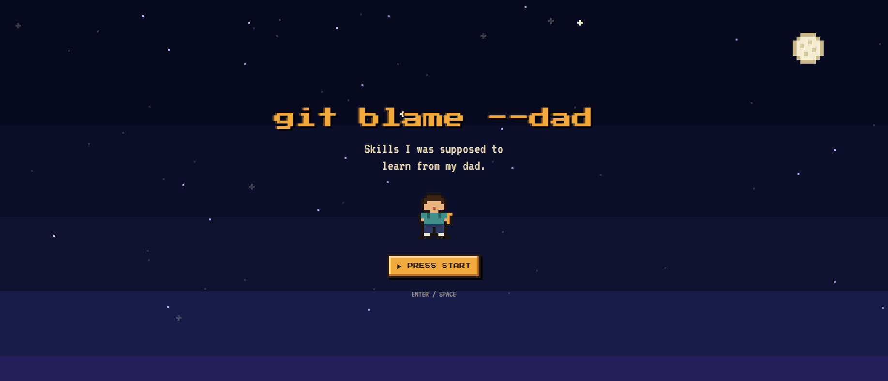
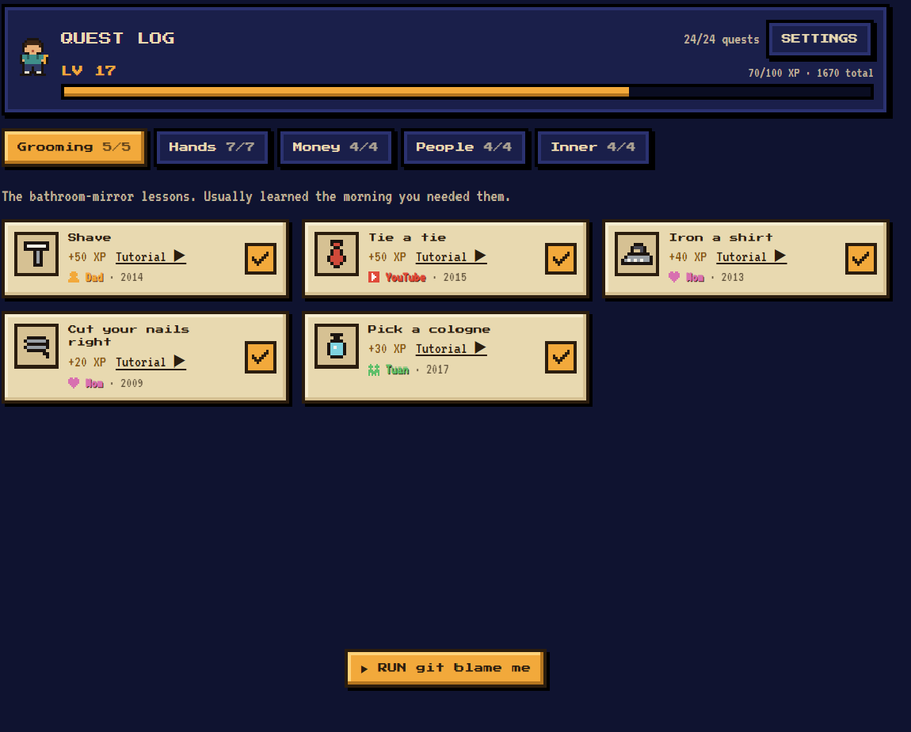
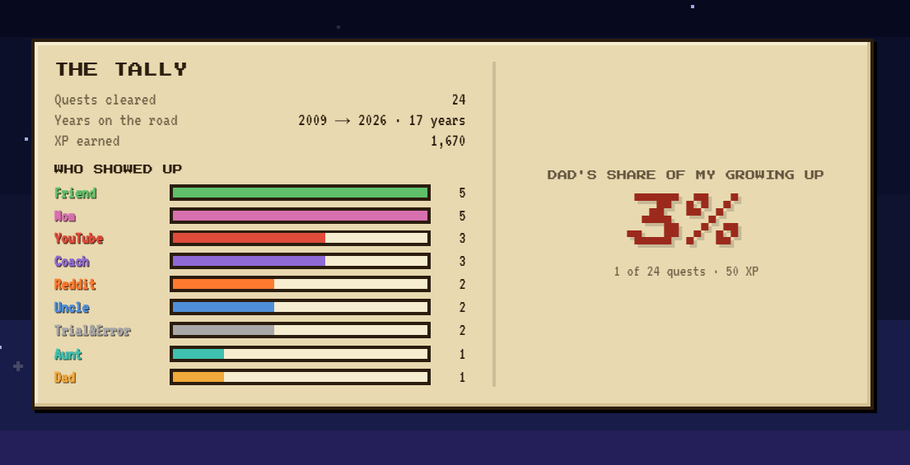

# git blame --dad

**Skills I was supposed to learn from my dad.**

A pixel-art RPG quest log of the things boys are supposed to pick up from their fathers: shaving, tying a tie, changing a tire, handling a breakup, saying "I'm not okay". You check off each skill and record **who actually taught you**, with an optional memory and photo. Then the game runs `git blame` on your life.

Built for a hackathon with the theme *"Build something that tells your story."*



| The quest log | The tally |
|---|---|
|  |  |

## The story

My dad wasn't around. Everything other boys learned from their fathers I learned from YouTube, Reddit, my mom, my uncle, my aunt, my friends, a coach, or by failing on my own. This app is that list, and a thank-you to the people who did show up.

## How it plays

1. **Title screen.** Night sky, a kid with a backpack. Press Start. From here you can also watch **Kai's story** (the original demo, at `/story`), open the **Hall of Blame**, or log in.
2. **Quest Log.** 43 skills across six regions: Grooming, Hands, Money, People, Inner and Backyard. Each quest card has a pixel icon, XP and a YouTube tutorial search link. Checking one asks **"WHO TAUGHT YOU THIS?"**: YouTube, Reddit, Uncle, Aunt, Friend, Mom, Teacher/Coach, Trial & Error, or Dad. You can add a name, a year, a one-line memory and a photo. Saving pops `+XP` with an 8-bit blip, levels go up every 100 XP, and each level range has a rank title, from *Lost Kid* to *The One Who Teaches*.
3. **Side Quests.** The things nobody put on the list. Write up to 12 of your own (40 XP each).
4. **Badges.** 15 of them, worked out fresh from your log every time: *Raised by the Internet*, *It Takes a Village*, *Both Jobs*, *He Showed Up*, *Every Line*… An 8-bit fanfare plays when one unlocks.
5. **`git blame me`.** Unlocks at 8 cleared quests (or press **B**). A slideshow of everything you learned, oldest first, with your photos. A **Dad meter** sits above it.
6. **The Tally.** Quests cleared, years on the road, XP, and a bar for every teacher who showed up. Dad's row waits on a blinking cursor, then resolves. **Dad's share of my growing up.** Then the final commit.
7. **Epilogue.** The hero, grown up, standing next to a new kid. From here, your profile or the Hall of Blame.

## Online: accounts, profiles and the Hall of Blame

With Supabase configured, players can sign in (email magic link, plus GitHub / Google / Discord if you switch them on) and get:

- **Cloud saves.** The log follows you across devices. Whatever you logged as a guest in that browser is brought over on first sign-in; if the account already has an answer for a quest, the account's answer wins.
- **A profile** at `/u/<handle>`: level and rank, Dad's share, a bar per teacher, a by-region table, badges, and the quest log in year order. Profile links unfurl into an image card with Dad's share on it.
- **The Hall of Blame** at `/hall`: a leaderboard you can sort by XP, quests, Dad's share or *village* (how many kinds of teacher showed up), totals across everyone, the quests most and least likely to have been taught by Dad, and **Who Taught the World**: every quest, with a bar of who taught it, across every public player.
- **Compare** at `/compare?a=<you>&b=<them>`: both logs side by side, the gap in Dad's share, and *same quest, different teacher*.

### Privacy

The stories in these logs are personal, so the defaults are cautious:

| What | Who sees it |
|---|---|
| Numbers: quests, XP, Dad's share, which *kind* of teacher | Everyone, unless you make your profile private |
| Words: teacher names, memories, side quest titles | Only you, unless you turn on **Share my words** |
| Photos | Only you, always. Private Storage bucket, signed URLs |

Nothing reads another player's rows directly. Every cross-player read goes through four `security definer` functions in the migration (`leaderboard`, `global_totals`, `skill_stats`, `get_profile`) that apply these rules in one place. Players can delete their account and everything in it from `/me`.

## Tech

- Next.js 15 (App Router), React 19, TypeScript, Tailwind CSS v4
- Supabase: Postgres with row-level security, Auth (PKCE magic links and OAuth via `@supabase/ssr`), and Storage for photos
- Without Supabase env vars the game runs guest-only: progress and photos in `localStorage`, no accounts
- Photos are downscaled in the browser to a 480px JPEG before they're saved anywhere
- Sprites are drawn from 2D character arrays onto a tiny `<canvas>` with `image-rendering: pixelated`. All art is original.
- Chiptune sound effects use the Web Audio API, start only after the first interaction, and can be muted
- Fonts: Press Start 2P and VT323
- Respects `prefers-reduced-motion`. Works at 1280×720 on a projector and at phone width.

## Run it

Guest-only, no setup:

```bash
npm install
npm run dev     # http://localhost:3000
```

With accounts, against a local Supabase (needs Docker). It runs on the 55xxx ports, so it can sit next to another local Supabase project:

```bash
npx supabase start          # prints the API URL and anon key
cp .env.example .env.local  # paste the anon key into NEXT_PUBLIC_SUPABASE_ANON_KEY
npm run dev
```

Magic-link emails land in the local inbox at http://127.0.0.1:55324.

```bash
npm test          # vitest
npm run typecheck
npm run build
```

## Deploy

1. **Supabase.** Create a project, then `npx supabase link --project-ref <ref>` and `npx supabase db push` to apply `supabase/migrations/`. In **Authentication → URL Configuration**, set the Site URL to your domain and add `https://<your-domain>/auth/callback` to the redirect URLs. For OAuth, enable each provider under **Authentication → Providers**.
2. **Vercel.** Import the repo. Set `NEXT_PUBLIC_SUPABASE_URL`, `NEXT_PUBLIC_SUPABASE_ANON_KEY`, `NEXT_PUBLIC_SITE_URL` and, optionally, `NEXT_PUBLIC_AUTH_PROVIDERS` (see `.env.example`). Deploy.

Any host that runs Next.js works; nothing here is Vercel-specific.

## Make it yours

The words live in two files:

- `data/skills.ts`: the quests and the seeded answers Kai's story opens with. Entries marked `TODO(Kai)` are placeholders. To give a seeded quest a photo, put the image in `public/photos/` and set `photo: "/photos/<file>.jpg"`.
- `data/story.ts`: titles, region blurbs, teacher names and colours, rank titles, your name and your final line (`BLAME.finalLine`).

**Adding a quest** takes two steps: add it to `data/skills.ts`, then add a migration that inserts it into the `skills` table with the same id, region and XP. The leaderboard scores XP in SQL, and `lib/skills-sql.test.ts` fails if the two disagree.

If you change the seeded answers, bump `DEMO_KEY` in `hooks/useSave.ts` (or press **Settings → Reset save** on `/story`) so a browser that already has an old save picks them up.

## Controls

| Key | Where | Does |
|---|---|---|
| Enter / Space | Title | Start |
| B | Quest Log | Jump straight to `git blame me`, skipping the unlock |
| ← → / Space | Slideshow | Previous / next / pause |
| Esc | Anywhere | Close the dialog or go back |
| Drag, drop or paste an image | Quest entry | Attach a photo |

---

*If you're going through something heavier, talk to someone you trust, or look up a mentoring program like Big Brothers Big Sisters.*
